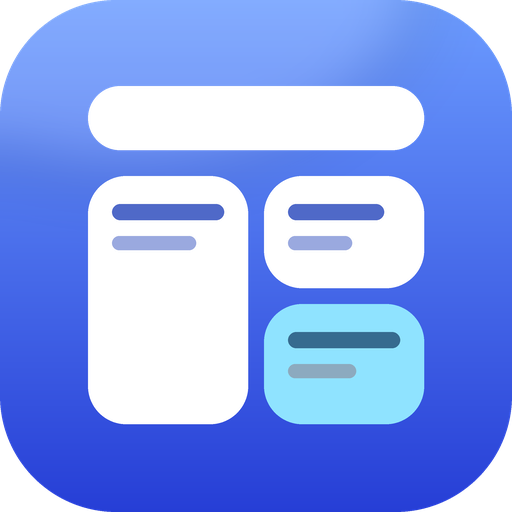

<div align="center">
  
</div>

<h1 align="center">高级主页 · Advanced Homepage</h1>

<p align="center"><sub>PCL Nex 启动器插件 · 把原版主页换成一块可以自由拼装的主页画布</sub></p>

---

<p align="center">
  <a href="https://github.com/Xinluo1145qwq/PCL-Nex_AdvancedHome/stargazers"></a>
  <a href="https://github.com/Xinluo1145qwq/PCL-Nex_AdvancedHome/releases/latest"></a>
  <a href="https://github.com/Xinluo1145qwq/PCL-Nex_AdvancedHome/issues"></a>
  <a href="https://github.com/Xinluo1145qwq/PCL-Nex_AdvancedHome/pulls"></a>
  <a href="https://github.com/Xinluo1145qwq/PCL-Nex_AdvancedHome/releases"></a>
  <a href="LICENSE"></a>
</p>

<p align="center">
  <a href="https://github.com/Xinluo1145qwq/PCL-Nex_AdvancedHome/releases/latest"><b>下载安装</b></a>
  &nbsp;|&nbsp;
  <a href="https://github.com/Xinluo1145qwq/PCL-Nex_AdvancedHome/issues/new/choose"><b>提交问题</b></a>
  &nbsp;|&nbsp;
  <a href="https://github.com/Xinluo1145qwq/PCL-Nex_AdvancedHome/releases"><b>更新日志</b></a>
</p>

高级主页是采用 **PCL Nex 插件开发标准** 制作的主页增强插件。它把启动器原本固定的主页换成一块 **9 列自适应网格画布**：卡片可以拖到自己喜欢的位置、拉成自己喜欢的大小，每一张的背景图与透明度还能单独调。默认提供 **花样 / 极简 / 便签** 三套模板，随时一键切换。

插件内置完整的 **Material Design 3 组件库** 与可视化设置中心（搜索、外观预览、组件库、重置与备份），主页上的一切都能在设置里改，不用手动编辑配置文件。

## 功能特性

- **三套主页模板**：花样（日历 + 启动热力）、极简（居中日期 + 标语轮播）、便签（随手记），各自记住自己的布局。
- **自由布局**：9 列网格，拖动卡片换位置、拖右下角手柄改大小，删掉的组件随时能加回来；布局存在本地，切模板不会互相覆盖。
- **17 种小组件**：日历热力、最近游玩的世界、最近游玩的实例、问候、标语卡片、便签、待办事项、单个实例 / 世界 / 服务器 / 网站入口、网站收藏、文件下载、3D 皮肤预览、时钟、天气、计算器。
- **每张卡片可单独定制**：背景图片、背景透明度（0–100%）、字号；皮肤卡还能换皮肤、开关交互。
- **主页入口**：编辑模式按钮左侧的齿轮按钮直接打开设置中心。
- **设置中心**：左侧导航 + 连续滚动内容，左上角搜索框按行过滤（`Ctrl+F` 聚焦、`Esc` 清空）；配色切换带平滑过渡，外观页提供主页实时预览。
- **Material Design 3**：按钮、开关、滑块、选项卡、对话框、菜单、底部面板、波浪进度条与不确定进度环，全部按 MD3 的动效与形状规范自绘，跟随启动器明暗主题。
- **重置与备份**：在设置里备份当前布局（带时间戳）、从备份恢复、导出 / 导入 `txt` 布局、重置布局。
- **组件库**：设置 → 通用 → 测试，可以现场把玩卡片、按钮、弹窗、导航、加载与动效等全部 MD3 组件。

## 安装

### 从插件市场安装（推荐）

在 PCL Nex 中打开 **设置 → 插件 → 插件市场**，搜索「高级主页」并安装。

插件市场通过 GitHub Topic [`pclnexplugin`](https://github.com/topics/pclnexplugin) 发现本插件，仓库根目录的 [`manifest.json`](manifest.json) 提供版本与下载信息。

### 手动安装

1. 到 [Releases](https://github.com/Xinluo1145qwq/PCL-Nex_AdvancedHome/releases/latest) 下载最新的 `.pclx`。
2. PCL Nex → **设置 → 插件 → 从文件安装**，选择下载好的 `.pclx`。
3. 重启启动器，主页即会换成高级主页。

> 需要 **PCL Nex 2026.10.25** 或更高版本；旧版启动器可能缺少插件接口。

## 使用

| 操作 | 说明 |
| --- | --- |
| 切换模板 | 主页顶部的「花样 / 极简 / 便签」 |
| 进入编辑 | 点顶部的铅笔按钮，出现网格线与添加按钮 |
| 添加组件 | 编辑模式下点「+」，按分类挑选 |
| 移动 / 缩放 | 拖卡片主体移动，拖右下角圆形手柄缩放 |
| 单卡设置 | 选中卡片 → 右上角「⚙」 |
| 打开设置中心 | 编辑按钮左侧的齿轮按钮 |

## 构建

环境要求：**Windows**、**.NET 10 SDK**、**PCL Nex**（用于引用 `PCL.Core.dll` 与 `Plain Craft Launcher 2.dll`）。

```powershell
# 1. 把启动器目录里的两个 DLL 放到 sdk/current/
#    PCL.Core.dll
#    Plain Craft Launcher 2.dll

# 2. 编译并打包，产物在 dist/
pwsh tools/build.ps1

# 只编译不打包
pwsh tools/build.ps1 -NoPack

# 同时部署到本地启动器（会覆盖 PCL/Plugins/com.pcln.advancedhomepage）
pwsh tools/build.ps1 -Deploy
```

打包出的 `.pclx` 就是插件压缩包（`plugin.json` + `lib/` + `mixins/`），可直接装进启动器或上传到 Release。

## 目录结构

```
src/AdvancedHomepage/     插件源码（WPF / net10.0-windows）
  HomeCanvas.cs           主页画布：网格、拖拽、缩放、编辑模式
  HomeTopBar.cs           主页顶部条（模板切换 / 编辑 / 设置入口）
  UiSettingsDialog.cs     设置中心
  ComponentGalleryDialog.cs 组件库
  M3*.cs                  Material Design 3 控件与动效
  package/                打包用 plugin.json、mixins、README
tools/build.ps1           构建 + 打包脚本
manifest.json             插件市场清单
sdk/                      编译期引用的启动器 DLL（不入库）
```

## 反馈与贡献

- 遇到 Bug 或有功能建议，请开 [Issue](https://github.com/Xinluo1145qwq/PCL-Nex_AdvancedHome/issues/new/choose)，附上启动器版本、插件版本与复现步骤。
- 欢迎 Pull Request：请保持现有代码风格（一个 `M3*.cs` 一类控件、注释写清「为什么」），并确保 `pwsh tools/build.ps1` 能通过。
- 提交代码即表示同意以 MIT 协议分发。

## 许可证

本项目使用 [MIT License](LICENSE) 开源。

插件中内置的 Steve / Alex 皮肤贴图版权归 Mojang Studios 所有，仅用于皮肤预览的默认展示。
